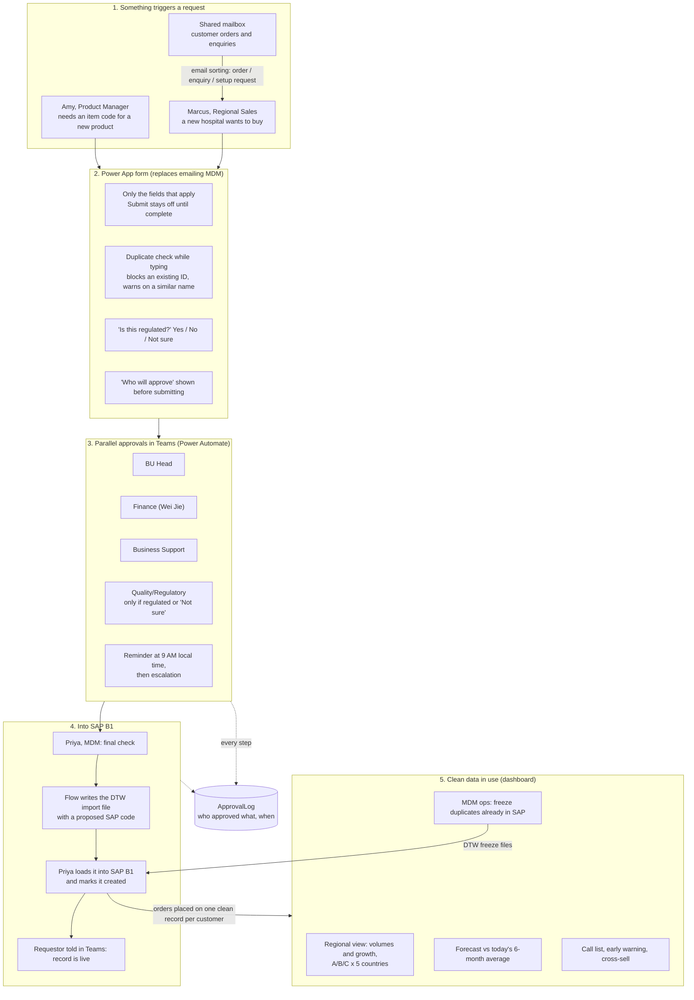

# Process flow: from request to SAP B1 to regional insight

The solution has two halves joined by clean master data: **clean records in at the front door** (form, parallel
approvals, SAP import file) and **better decisions out the back** (one regional view, forecasts and sales actions
built on those records). The technical wiring (lists, flows, columns) is in the
[build guide](M365_BUILD.md#how-the-pieces-fit); this page follows the people.

## Step by step

### 1. Something triggers a request
- **Amy (Product Manager)** needs a new item code before a newly sourced lab consumable can be sold.
- **Marcus (Regional Sales)** needs a new customer set up because a new hospital wants to buy.
- **Customer emails are a separate stream.** Orders and enquiries arrive in the shared mailbox; email sorting splits
  them into orders (counted in the regional view), enquiries and follow-ups (left out), and setup requests (passed
  to the people who raise them).
- **Staff who still email the MDM mailbox** get an automatic reply with the form link.

### 2. The requestor fills in the Power App form
- It shows only the fields that apply to the request type, from the **RequiredFields** list. **Submit** stays off
  until the request is complete and plausible (no *N/A* or *TBC*, format checks on IDs).
- **Duplicate check while typing**, against SAP's records and requests already waiting: a matching registration
  no., part no. or tax ID is blocked and names the code to use instead; a similar name is a *Possible match*, and
  going ahead needs a reason that every approver sees.
- **"Is this regulated?"** offers *Not sure*, which sends the item to Quality/Regulatory instead of the requestor
  guessing.
- **"Who will approve"** lists the approvers by name before submitting, from the same rules the flow uses.

### 3. Approvals run in parallel
Who is asked depends on the request type (**RoutingRules** list, which the MDM team edits without IT):

| Request | Approve at the same time |
|---|---|
| Item | BU Head, Business Support, + Quality/Regulatory if regulated or *Not sure* |
| Customer | BU Head, Finance, Business Support |
| Vendor | BU Head, Finance, Business Support, + Quality/Regulatory if it supplies regulated goods |
| Cost centre | Finance, BU Head |

- Each approver gets a Teams/Outlook card: **Approve / Request changes / Reject**. *Request changes* goes straight
  back to the requestor, who edits and resubmits; only that approver checks it again.
- A reminder goes out at 9 AM in the approver's own time zone once the step is overdue, then an escalation.
- The requestor sees in **My requests** who it is still waiting on.
- A business unit with nobody set up for a step (Marcus's new team) goes to the MDM Analyst instead of stalling.
- Bank details and credit terms sit in a separate restricted list; approval cards carry a link, never the values.

### 4. Final check and into SAP B1
1. **Priya (MDM Analyst)** approves last.
2. The flow writes a **SAP Data Transfer Workbench (DTW) import file** to a restricted folder, with a proposed SAP
   code (e.g. `C20007`), and adds the record to the master list at once so the next duplicate check sees it.
3. Priya loads the file into SAP B1 and presses **Mark as created in SAP**.
4. The requestor is told in Teams that the record is live.
5. Every step, from submission to SAP, is a row in **ApprovalLog**.

### 5. Clean data in use
- Orders placed on clean records feed the **regional view** (this Streamlit app; Power BI in production): purchase-order
  volumes and year-on-year growth for Products A, B and C in five countries, a forecast compared with today's
  6-month average, and sales actions (call list, early warning, cross-sell).
- Duplicates already in SAP are cleaned up from the **MDM ops** page, which downloads DTW files that **freeze** the
  extra records (kept for history, never used again) with a note naming the record to use instead.
- Because new duplicates are blocked at the form and old ones are frozen, one hospital counts as **one customer across
  SPD, QTS and QTG**. That is what makes the drop-off and cross-sell lists trustworthy.

## Before and after

| | Today (email) | OneRecord |
|---|---|---|
| Starting a request | Free-text email, copied from an old request | Form with only the fields that apply |
| Duplicates | Whoever happens to remember | Checked while typing, blocked or flagged |
| Approvals | One after another, noticed when someone checks email | In parallel, Teams cards, reminders, escalation |
| Status | Ask the MDM mailbox | *My requests* shows who it is waiting on |
| Audit | Scattered email threads | ApprovalLog, only ever added to |
| Into SAP | Keyed in by hand | Import file generated by the flow |
| Median time to SAP | 18.8 days | about 4–6 days (simulated on the same 150 requests; 6 even if reminders changed nothing) |
